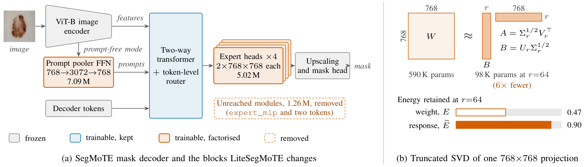
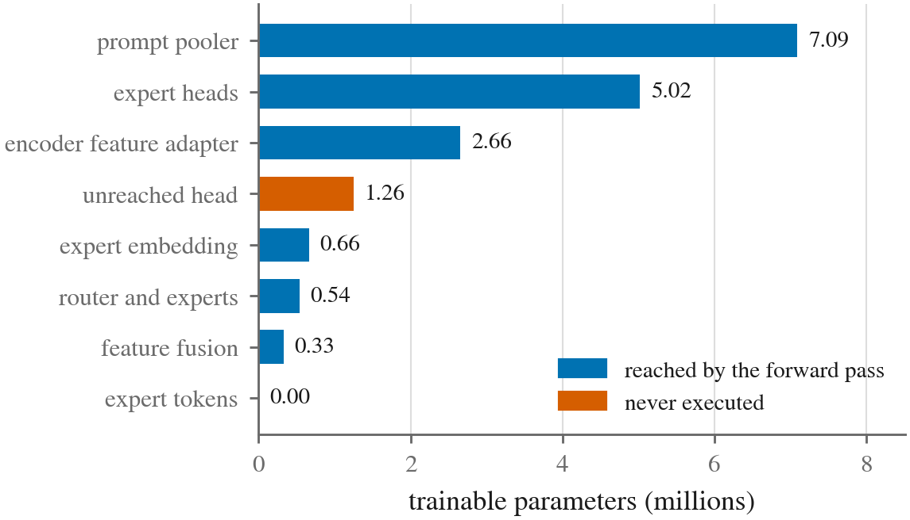
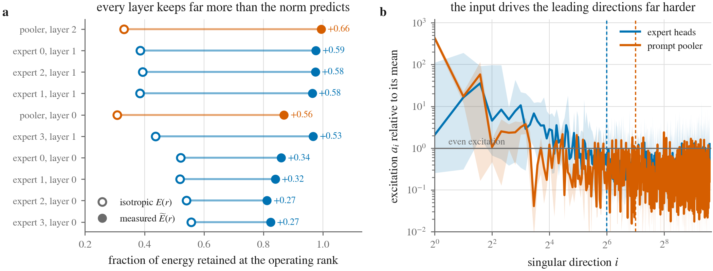
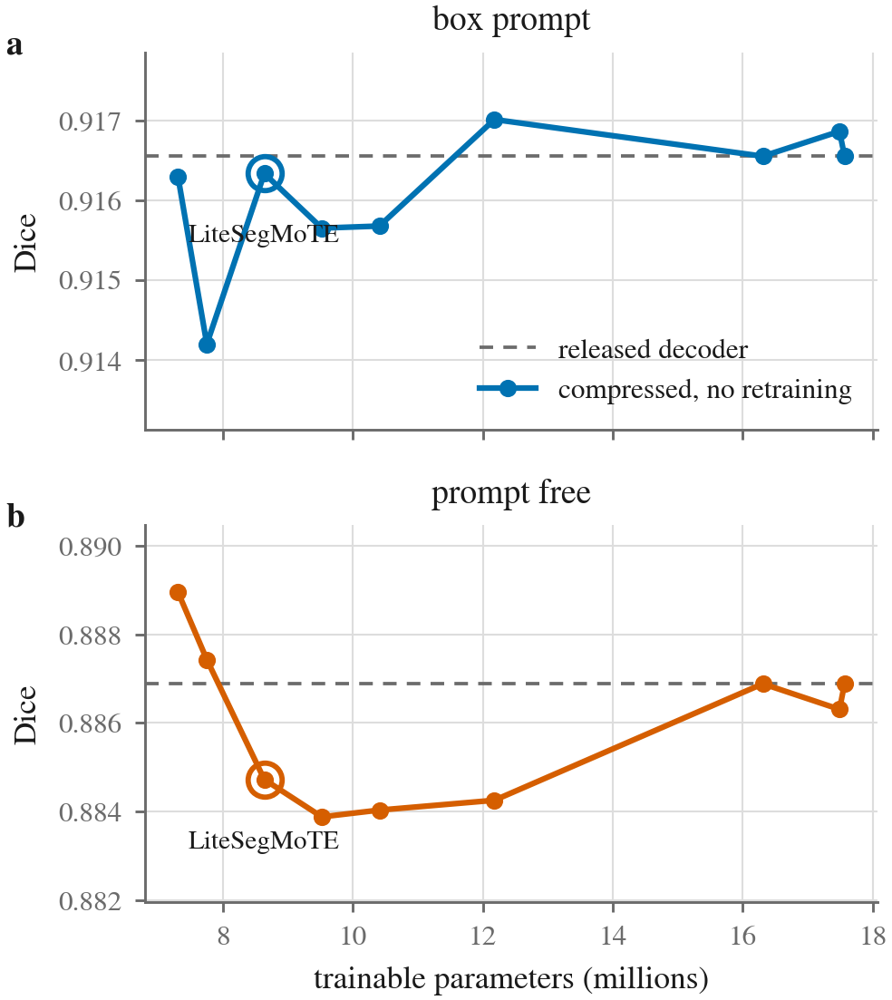
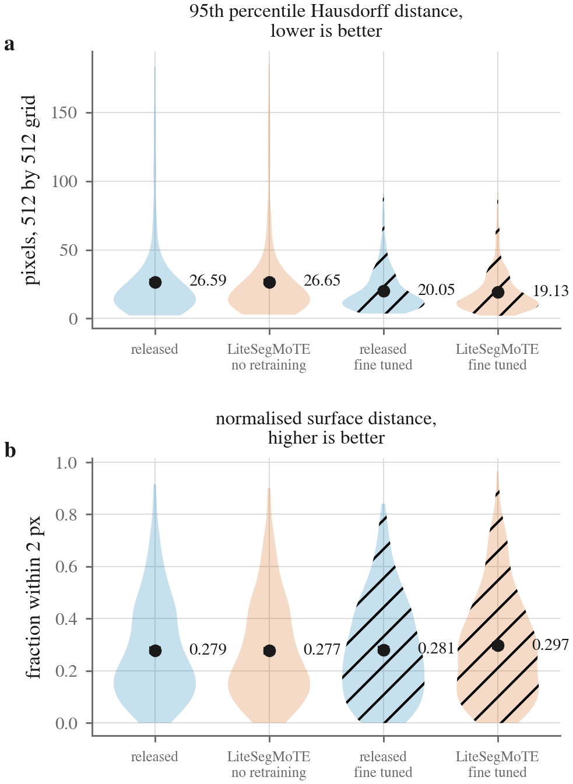
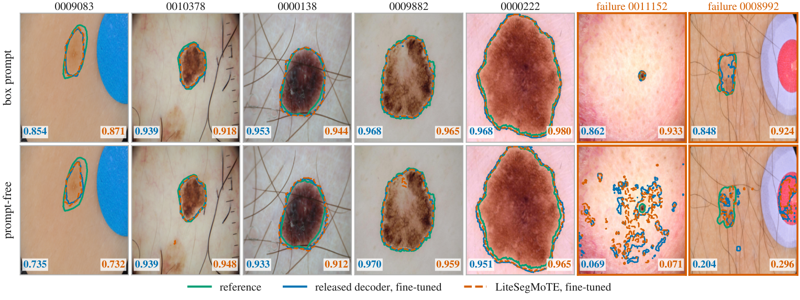

# LiteSegMoTE

Low-rank compression of the SegMoTE mask decoder for medical image segmentation. Three
decoder modules that the forward pass never reaches are removed, and the widest
projections are replaced by truncated singular value factorisations of the released
weights. The trainable decoder falls from 17.56 M to 8.64 M parameters, with
segmentation quality held on the ISIC 2016 lesion benchmark under both box-prompted and
prompt-free interaction.

## Background

Parameter-efficient adaptation of the Segment Anything Model (SAM) to medical images
freezes the pretrained encoder and trains a small module on top of it. SegMoTE
(Lu et al., CVPR 2026, [doi:10.48550/arXiv.2602.19213](https://doi.org/10.48550/arXiv.2602.19213))
follows this design with a mask decoder of 17.56 M trainable parameters that combines a
token-level mixture of experts with a progressive prompt tokenisation module, so that
binary foreground tasks can also be segmented without user prompts. The decoder works at
width 768 against 256 in the original SAM decoder, so each square projection is nine
times larger than its counterpart.

Low-rank methods such as LoRA restrict the rank *before* training. Here the trained
weights, which were free to use their full rank, are factorised *after* training, so the
measured redundancy is a property of the converged decoder. The analysis also explains
why a truncation that discards most of the weight energy costs little accuracy: the
encoder features that reach the decoder excite only a few singular directions of each
layer.

## Method



*(a) The SegMoTE mask decoder: compression is confined to the two widest trainable
blocks and to three modules that the forward pass never reaches (parameter counts of the
released decoder). (b) Each wide projection is replaced by two thin factors initialised
from its truncated SVD; at the adopted rank this keeps 0.47 of the weight norm but 0.90
of the response the layer produces.*

An audit of the released weights reconstructs 200,080,336 parameters, of which
17,563,776 are trainable. Three modules (`expert_mlp`, `text_token` and
`boxApoint_token`, 1,256,544 parameters together) appear in the parameter count but in
no expression that reaches an output.

<p align="center">
  
</p>

*Trainable parameters of the released decoder by module; orange modules are never
executed.*

The compression has three parts:

- **Pruning** of the three unreached modules, which cannot change any output.
- **Expert head factorisation**: the two square 768 × 768 projections inside each of the
  four per-expert output heads are factorised at rank $`r_e = 64`$, independently, so the
  specialisation induced by the router is kept.
- **Prompt pooler factorisation**: the feed-forward block of the prompt pooler
  (768 → 3072 → 768) is factorised at rank $`r_p = 128`$.

Each targeted projection $`W \in \mathbb{R}^{m \times n}`$ with singular value
decomposition $`W = U \Sigma V^{\top}`$ is replaced by two factors that split the leading
$`r`$ singular values symmetrically,

```math
A = \Sigma_r^{1/2} V_r^{\top}, \qquad B = U_r \Sigma_r^{1/2}, \qquad W \approx BA ,
```

so that $`BA`$ is the best rank-$`r`$ approximation of $`W`$ and the parameter count falls
from $`mn`$ to $`r(m+n)`$. The factors start from the released weights, so the compressed
decoder is usable before any optimisation. With $`d = 768`$ and $`P_0`$ the trainable
tensors that are not factorised, the budget for any rank pair is

```math
P(r_e, r_p) = P_0 + 8\,r_e\,(d + d) + 2\,r_p\,(d + 4d) = 6{,}870{,}048 + 12{,}288\,r_e + 7{,}680\,r_p ,
```

which gives 8,639,520 parameters at $`(64, 128)`$, a 50.8 % reduction. Because $`P_0`$ is
fixed, factorising these two blocks alone cannot reduce the decoder by more than 60.9 %.

The rank is usually chosen from the fraction of squared spectral energy a truncation
keeps, $`E(r) = \sum_{i \le r} \sigma_i^2 / \sum_i \sigma_i^2`$. At the adopted ranks this
is only 0.47 for the expert heads and 0.32 for the pooler. A layer, however, only sees
the activations the frozen encoder produces. Direction $`i`$ contributes
$`\sigma_i^2 a_i`$ to the mean squared output, with $`a_i = \mathbb{E}_x[(v_i^{\top} x)^2]`$
over the inputs the layer actually receives, so the fraction of the response a truncation
keeps is

```math
\widetilde{E}(r) = \frac{\sum_{i=1}^{r} \sigma_i^2 a_i}{\sum_{i=1}^{n} \sigma_i^2 a_i}.
```

For isotropic input, $`\mathbb{E}_x[xx^{\top}] = \alpha I`$, the two criteria coincide.
Measured over 150 test images in both interaction modes, the same ranks keep
$`\widetilde{E} = 0.90`$ in the expert heads and $`0.93`$ in the pooler.



*(a) Energy retained by every factorised layer at its operating rank under the isotropic
criterion (hollow) and the measured criterion (filled). (b) Excitation a<sub>i</sub> of
each singular direction relative to its mean (median across the layers of a block; band:
their range; dashed: operating ranks).*

## Results

All results are on the 379-image ISIC 2016 test set. Box prompting supplies the tight
bounding box of the reference mask; in the prompt-free mode the prompt tokenisation
module builds the prompt from image features.

### Compression without retraining

| Configuration | Trainable | Reduction | Box Dice | Prompt-free Dice |
|---|---|---|---|---|
| Released decoder | 17.56 M | 0.0 % | 0.9165 | 0.8869 |
| Pruning only | 16.31 M | 7.2 % | 0.9165 | 0.8869 |
| r = (192, 384) | 12.18 M | 30.7 % | 0.9170 | 0.8843 |
| r = (128, 256) | 10.41 M | 40.7 % | 0.9157 | 0.8840 |
| r = (96, 192) | 9.52 M | 45.8 % | 0.9156 | 0.8839 |
| **r = (64, 128), LiteSegMoTE** | **8.64 M** | **50.8 %** | **0.9163** | **0.8847** |
| r = (32, 64) | 7.75 M | 55.8 % | 0.9142 | 0.8874 |
| r = (16, 32) | 7.31 M | 58.4 % | 0.9163 | 0.8890 |

Ranks are given as (expert head, prompt pooler). Pruning reproduces the released scores
to four decimal places. At (64, 128) the decoder stays within 0.0002 Dice of the released
model with a box prompt and within 0.0022 without, although the mean relative Frobenius
error of the factorised weights is 0.73 for the expert heads and 0.83 for the pooler.

<p align="center">
  
</p>

*Test Dice against trainable parameters with no gradient update, box prompt (a) and
prompt free (b); dashed: the released decoder; circled: LiteSegMoTE.*

| Factorised blocks | Trainable | Box Dice | Prompt-free Dice |
|---|---|---|---|
| None (pruning only) | 16.31 M | 0.9165 | 0.8869 |
| Expert heads, r_e = 64 | 12.38 M | 0.9163 | 0.8860 |
| Prompt pooler, r_p = 128 | 12.57 M | 0.9165 | 0.8854 |
| Both (LiteSegMoTE) | 8.64 M | 0.9163 | 0.8847 |
| Both + encoder feature adapter, r = 64 | 6.53 M | 0.9165 | 0.8849 |

The expert heads carry the whole box-prompt cost; without prompts, the pooler, which
builds the prompt, is the most sensitive block. Factorising also the transposed
convolution of the encoder feature adapter brings the reduction to 62.8 % within 0.002
Dice.

### Matched fine-tuning

Both decoders were fine-tuned with the same data, schedule and selection rule; the epoch
is selected on a fixed validation split and the test set is scored once.

| Decoder | Trainable | Seeds | Box Dice | Prompt-free Dice |
|---|---|---|---|---|
| Released | 17.56 M | 2 | 0.9351 ± 0.0036 | 0.8952 ± 0.0047 |
| LiteSegMoTE | 8.64 M | 1 | 0.9356 | 0.9030 |

Against the seed-0 control on the same 379 images, the mean per-image difference is
+0.0031 Dice with a box prompt (Wilcoxon p < 10⁻³; median +0.0015) and +0.0111 without
(p = 0.178; median −0.0002). With one compressed seed against two control seeds, these
results support equivalence rather than superiority.

| Decoder | Mode | Dice | HD95 (px) | NSD |
|---|---|---|---|---|
| Released | box | 0.9165 | 26.59 | 0.2785 |
|  | prompt free | 0.8869 | 34.09 | 0.2233 |
| LiteSegMoTE, no retraining | box | 0.9163 | 26.65 | 0.2772 |
|  | prompt free | 0.8847 | 34.39 | 0.2230 |
| Released, fine-tuned | box | 0.9326 | 20.05 | 0.2811 |
|  | prompt free | 0.8919 | 33.16 | 0.2251 |
| LiteSegMoTE, fine-tuned | box | 0.9356 | 19.13 | 0.2971 |
|  | prompt free | 0.9030 | 31.62 | 0.2336 |

HD95 and NSD (tolerance 2 pixels) are computed on a common 512 × 512 grid and Dice at
native resolution; fine-tuned rows are seed 0.

<p align="center">
  
</p>

*HD95 (a) and NSD (b) under box prompting for the four model states (dots and numbers:
means; hatched: fine-tuned).*

Halving the trainable parameters does not change the arithmetic: the decoder needs
14.088 GMAC before and 14.085 GMAC after compression at 512 × 512, and its latency is
15.08 ± 1.41 ms against 14.80 ± 1.07 ms, because decoder compute is dominated by
attention over the frozen image embeddings. The gain is a smaller optimiser state during
adaptation and half the storage for each specialised decoder kept against a shared
backbone.

### Qualitative results



*Fine-tuned released decoder (blue) and LiteSegMoTE (orange, dashed) against the
reference (green), with each decoder's Dice. The first five columns sit at evenly spaced
quantiles of the LiteSegMoTE box-prompt Dice; the last two are the images with the lowest
prompt-free Dice.*

The two decoders trace nearly the same contours. The failures occur in the prompt-free
mode and are shared by both decoders: on image 0011152 the self-generated prompt scatters
the mask over textured skin (Dice 0.069 and 0.071) although a box prompt recovers the
lesion (0.862 and 0.933), and on image 0008992 both segment a red circular marker beside
the lesion (0.204 and 0.296).

## Installation

```bash
git clone https://github.com/farhatmasood/litesegmote.git
cd litesegmote
conda create -n litesegmote python=3.10 -y
conda activate litesegmote
pip install torch==2.4.1 torchvision==0.19.1 --index-url https://download.pytorch.org/whl/cu121
pip install -r requirements.txt
```

Install the CUDA build of PyTorch before `requirements.txt`; an unpinned `transformers`
release would replace it with a CPU-only wheel. A GPU with 8 GB of memory is sufficient.

The SegMoTE sources are fetched at the pinned commit used for all experiments, and the
released weights and the ISIC 2016 data are downloaded into `checkpoints/` and
`datasets/`:

```bash
python setup_upstream.py --dest third_party/segmote

mkdir -p checkpoints
curl -L -o checkpoints/sam_b.pth   https://huggingface.co/yujielu/SegMoTE/resolve/main/sam_b.pth
curl -L -o checkpoints/segmote.pth https://huggingface.co/yujielu/SegMoTE/resolve/main/segmote.pth

mkdir -p datasets/isic2016_train datasets/isic2016_test
BASE=https://isic-challenge-data.s3.amazonaws.com/2016
curl -L -o datasets/isic2016_train/images.zip $BASE/ISBI2016_ISIC_Part1_Training_Data.zip
curl -L -o datasets/isic2016_train/masks.zip  $BASE/ISBI2016_ISIC_Part1_Training_GroundTruth.zip
curl -L -o datasets/isic2016_test/images.zip  $BASE/ISBI2016_ISIC_Part1_Test_Data.zip
curl -L -o datasets/isic2016_test/masks.zip   $BASE/ISBI2016_ISIC_Part1_Test_GroundTruth.zip
# extract each archive in place
```

`sam_b.pth` is needed even for evaluation: SegMoTE decides which decoder tensors stay
frozen by comparison with it.

## Usage

Compress the released decoder and evaluate it in Python:

```python
from segmote_lite import apply_recipe, build_segmote, count_trainable, freeze_backbone

model = build_segmote("third_party/segmote", "checkpoints/sam_b.pth", "checkpoints/segmote.pth")
freeze_backbone(model)
apply_recipe(model, expert_rank=64, pooler_rank=128)
print(count_trainable(model))        # 8639520 trainable decoder parameters
```

Run all experiments in order (stages with existing outputs are skipped):

```bash
python run_all.py
```

| Script (`experiments/`) | Experiment |
|---|---|
| `run_param_audit.py` | location of the trainable parameters, unreached modules |
| `run_spectra.py` | singular value spectra and isotropic energy retention |
| `run_excitation.py` | excitation-weighted retention on test images |
| `run_datafree_sweep.py` | Dice against rank with no gradient update |
| `run_component_ablation.py` | each block of the recipe applied alone |
| `run_sweep.py`, `run_finetune.py` | matched fine-tuning of both decoders over seeds |
| `run_statistics.py` | paired per-image tests |
| `run_boundary_metrics.py` | HD95 and NSD for four model states |
| `run_efficiency.py` | decoder latency, multiply-accumulate count and memory |
| `evaluate_checkpoint.py` | test Dice of fine-tuned decoder checkpoints in both interaction modes |

Each script takes `--segmote_root`, `--sam_checkpoint`, `--segmote_checkpoint` and the
data folders as arguments; `--help` lists them. The outputs of the reported runs are in
`results/`.

## Repository structure

```
segmote_lite/      compression library
  lowrank.py       truncated-SVD factorisation of linear and transposed-convolution layers
  compress.py      pruning, factorisation and parameter accounting
  builder.py       model construction against the pinned SegMoTE sources
  data.py          ISIC 2016 loading, preprocessing and the train/validation split
  evaluate.py      Dice under box-prompted and prompt-free interaction
  metrics.py       Dice, HD95 and normalised surface distance
experiments/       one script per experiment
results/           outputs of the reported runs (JSON, CSV, NPZ)
setup_upstream.py  fetches the SegMoTE sources at the pinned commit
run_all.py         runs the experiments in order
```

## Citation

```bibtex
@unpublished{masood2026litesegmote,
  title  = {{LiteSegMoTE}: Low-Rank Redundancy in Token-Level Expert Decoders for Medical
            Image Segmentation},
  author = {Masood, Rao Farhat and Safdar, Aon},
  year   = {2026},
  note   = {Manuscript under review}
}
```

## License

MIT, see [LICENSE](LICENSE). This work builds on SegMoTE (MIT,
<https://github.com/InMyDreammer/SegMoTE>) and the Segment Anything Model (Apache 2.0),
whose sources are fetched rather than redistributed. The ISIC 2016 data (Gutman et al.,
2016, [doi:10.48550/arXiv.1605.01397](https://doi.org/10.48550/arXiv.1605.01397)) are not
included; the example images shown above are ISIC 2016 test images. See [NOTICE](NOTICE).
